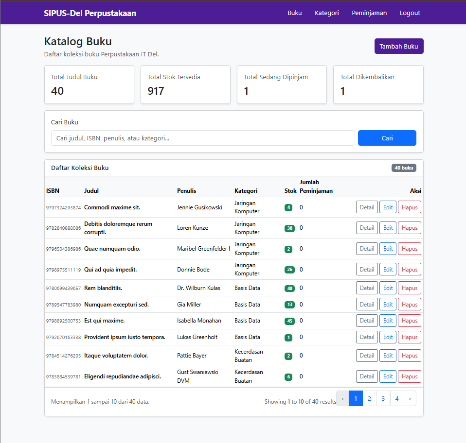
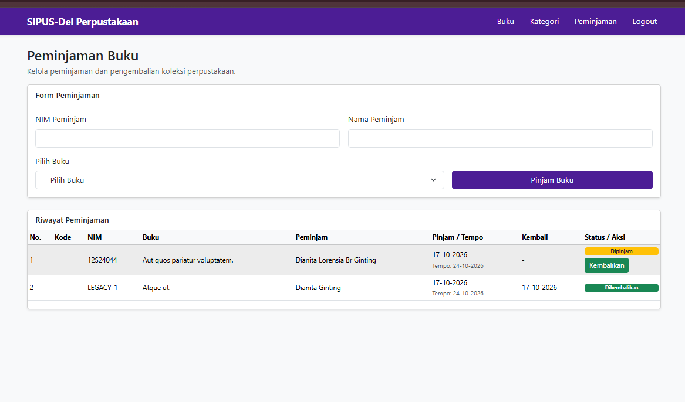
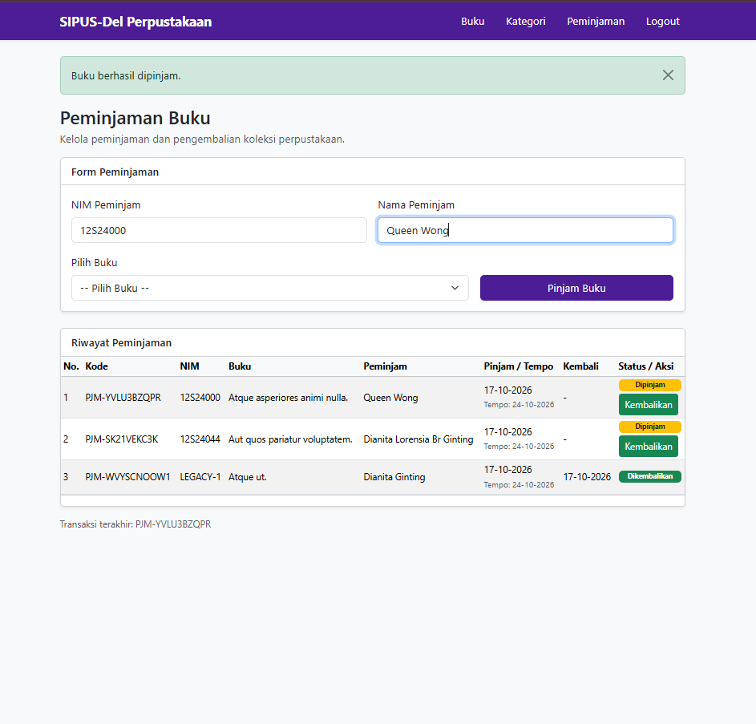
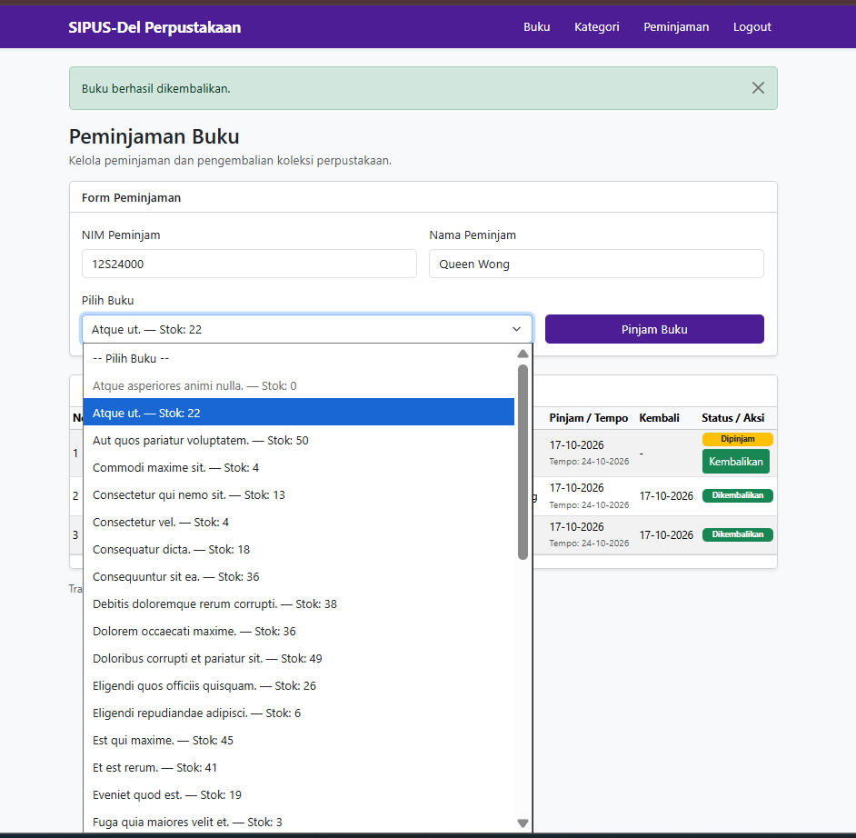
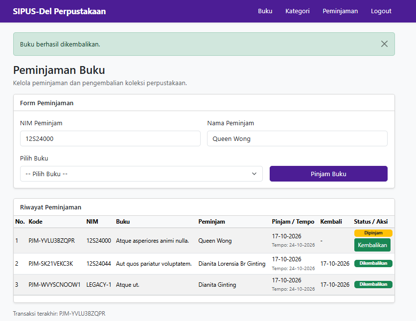
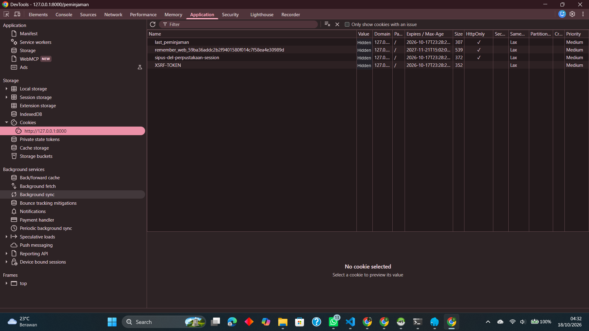

# SIPUS-Del — Tugas Mandiri Modul Minggu 6

SIPUS-Del adalah aplikasi pengelolaan katalog dan peminjaman buku Perpustakaan
Kampus Institut Teknologi Del. Repository ini melanjutkan proyek Minggu 5 dan
difokuskan pada **Tugas Mandiri Mahasiswa (SIPUS-Del tahap 2)**: relasi transaksi,
stok yang konsisten, pencarian dan statistik katalog, serta autentikasi petugas.

## Kesesuaian dengan Tugas Mandiri dan Rubrik

| Kriteria penilaian | Bobot | Implementasi |
| --- | ---: | --- |
| Skema tabel peminjaman dan relasi Eloquent | 20% | `peminjamen` memiliki `kode_pinjam` unik dan foreign key ke `bukus`; `Buku` memiliki banyak peminjaman dan `Peminjaman` terkait ke satu buku. |
| Transaksi ACID dan concurrency locking | 25% | `PeminjamanService` membungkus pinjam/kembali dalam `DB::transaction()`, mengunci baris dengan `lockForUpdate()`, menolak stok nol, dan mencegah pengembalian ganda. |
| Query Builder, `withCount`, pencarian, dan statistik | 15% | Katalog menampilkan jumlah riwayat pinjam per buku, mendukung pencarian judul/penulis/ISBN/kategori dan pagination, serta statistik total judul, stok, transaksi dipinjam, dan dikembalikan. Pencarian terakhir disimpan di Session. |
| Session, cookie, dan autentikasi petugas | 25% | Login menggunakan `Auth::attempt()`, rotasi session, opsi “Ingat saya”, logout yang menginvalidasi session dan token CSRF, serta rute aplikasi yang dilindungi middleware `auth`. Sesudah peminjaman berhasil, data peminjam/transaksi disimpan dalam Session dan kode transaksi dikirim melalui cookie `HttpOnly`, `SameSite=Lax` memakai `Cookie::queue()`. |
| Seeder, bukti uji transaksi, dan dokumentasi | 15% | Seeder membuat akun demo, buku stok 0/1, serta transaksi aktif/selesai; tes mencakup rollback, stok, login, logout, cookie HttpOnly, dan akses rute. Panduan verifikasi ada di bawah. |

## Teknologi

- Laravel 13 dan PHP `^8.3` (pengembangan saat ini menggunakan PHP 8.5).
- SQLite untuk pengembangan lokal; MySQL/InnoDB dapat dipakai untuk uji row-lock
  concurrency yang sesungguhnya.
- Bootstrap 5 dan Vite.
- PHPUnit.

## Menjalankan di Windows

Pastikan branch tugas aktif:

```powershell
git switch week6-db-session
```

Siapkan aplikasi dari root repository:

```powershell
composer install
Copy-Item .env.example .env
php artisan key:generate
```

Konfigurasi `.env` agar memakai SQLite. Buat file database jika belum tersedia,
lalu jalankan migrasi dan seeder:

```powershell
if (!(Test-Path database\database.sqlite)) {
    New-Item -ItemType File -Path database\database.sqlite
}
php artisan migrate:fresh --seed
npm install
npm run build
php artisan serve
```

> `migrate:fresh` menghapus seluruh tabel dan data pada koneksi database yang
> dikonfigurasi. Gunakan hanya untuk database pengembangan yang boleh di-reset.

Buka `http://127.0.0.1:8000`.

### Akun Demo

| Email | Kata sandi |
| --- | --- |
| `pustakawan@del.ac.id` | `password123` |

Akun dibuat oleh `PetugasSeeder` untuk keperluan demo lokal. Ganti kredensial
sebelum aplikasi dipakai di lingkungan selain pengembangan.

## Fitur dan Alur Verifikasi Manual

1. **Login petugas:** masuk memakai akun demo. Login gagal menampilkan pesan
   validasi; login berhasil merotasi session dan mengarahkan ke katalog.
2. **Katalog:** lihat total judul, jumlah eksemplar yang tersedia, transaksi
   yang masih dipinjam/dikembalikan, jumlah riwayat pinjam per buku, dan pagination. Coba
   pencarian dengan judul, penulis, atau ISBN.
   Setelah pencarian, kembali ke katalog tanpa parameter untuk melihat pencarian
   terakhir yang tersimpan di Session.
3. **Peminjaman:** pada menu Peminjaman, pilih buku yang memiliki stok. Seeder
   menyediakan `Laravel untuk Perpustakaan` dengan stok 1; setelah dipinjam,
   stok menjadi 0.
4. **Penolakan stok kosong:** `Dasar-Dasar Basis Data` disediakan dengan stok 0.
   Form menonaktifkan pilihan itu dan server tetap menolak permintaan langsung
   untuk mencegah stok negatif.
5. **Pengembalian:** gunakan aksi Kembalikan pada transaksi berstatus Dipinjam.
   Stok bertambah satu kali; transaksi yang telah dikembalikan tidak dapat
   diproses ulang.
6. **Session dan cookie transaksi:** sesudah peminjaman berhasil, NIM/nama
   peminjam dan kode transaksi terakhir tersimpan di Session; form peminjaman
   mengisi ulang NIM/nama saat halaman dibuka kembali. Cookie `last_peminjaman`
   diantrekan menggunakan `Cookie::queue()` dengan flag `HttpOnly` dan
   `SameSite=Lax`. Buka Developer Tools browser → **Application** → **Cookies**
   atau **Network** → respons POST peminjaman untuk memeriksanya.
7. **Cookie session:** setelah login, cookie session juga harus memiliki
   flag `HttpOnly` dan `SameSite=Lax`. Pengaturan lokal tersedia di `.env`:
   `SESSION_HTTP_ONLY=true`, `SESSION_SAME_SITE=lax`, dan masa idle default
   `SESSION_LIFETIME=120` menit.
8. **Logout:** gunakan tombol Logout. Session dan token CSRF lama diinvalidasi;
   halaman yang dilindungi meminta login kembali.

Untuk menguji lock baris pada banyak permintaan serentak, gunakan MySQL/InnoDB.
SQLite cocok untuk demonstrasi alur dan pengujian otomatis, tetapi tidak
memberikan row-level `FOR UPDATE` dengan semantik yang sama.

## Struktur Database dan Kode Utama

- `kategoris` dan `bukus`: katalog Minggu 5 beserta relasi kategori.
- `peminjamen`: kode peminjaman unik, buku, NIM/nama peminjam, tanggal pinjam,
  jatuh tempo, tanggal kembali, serta status `dipinjam` atau `dikembalikan`.
- `app/Models/Buku.php` dan `app/Models/Peminjaman.php`: relasi Eloquent.
- `app/Services/PeminjamanService.php`: operasi pinjam/kembali atomik dan
  penguncian baris.
- `app/Http/Controllers/BukuController.php`: pencarian, `withCount`, pagination,
  serta statistik katalog berbasis `DB::table()`.
- `app/Http/Controllers/Auth/PetugasAuthController.php` dan `routes/web.php`:
  autentikasi, logout aman, dan proteksi middleware.
- `database/seeders/`: data katalog, transaksi contoh, dan akun petugas.

## Pengujian dan Pemeriksaan Gaya

Jalankan seluruh tes:

```powershell
php artisan test
```

Tes mencakup CRUD katalog, jumlah peminjaman dan seluruh statistik, penyimpanan
pencarian dan transaksi terakhir di Session, stok kosong, rollback ketika
penyimpanan transaksi gagal, pengembalian ganda, autentikasi, proteksi rute,
serta flag HttpOnly/SameSite pada cookie.

Pemeriksaan format PHP:

```powershell
vendor/bin/pint --test
```

## Lampiran Bukti Visual

Tampilan berikut berasal dari aplikasi lokal yang sudah dijalankan dengan
seeder. Screenshot penolakan stok nol memperlihatkan pilihan stok 0 yang
dinonaktifkan; validasi sisi server untuk permintaan peminjaman stok 0 juga
dicakup oleh tes `PeminjamanServiceTest`.

### Katalog dan Statistik



### Form dan Riwayat Peminjaman



### Peminjaman Berhasil



### Penolakan Buku dengan Stok Nol



### Pengembalian Buku



### Pemeriksaan Cookie



Cookie `last_peminjaman` terlihat memiliki flag `HttpOnly` dan `SameSite=Lax`.
Nilai cookie pada screenshot disamarkan agar tidak membocorkan token sesi atau
transaksi. Tes otomatis `PeminjamanServiceTest` juga memverifikasi atribut
cookie tersebut.

Jangan menggunakan screenshot yang memuat kredensial selain akun demo atau data
pribadi.
